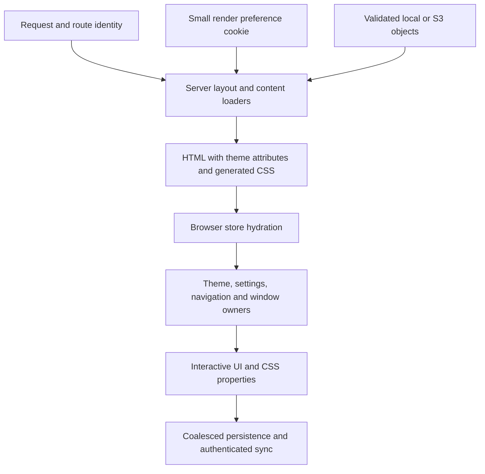

# Application runtime

Reviewed October 12, 2026, including the focused execution repairs following `91d20ccf`. [Documentation index](../README.md).

## One request, then browser ownership

The application uses Next App Router and React. Routes under `src/app` compose public feature exports; active implementation lives under `src/features`, shared primitives under `src/ui` and `src/lib`, and trusted storage/session/content operations under `src/server`. `/photos` redirects to canonical `/album`.

[`src/app/layout.tsx`](../../src/app/layout.tsx) establishes fonts, initial theme/scheme attributes, providers, and global hosts. [`render-preferences.ts`](../../src/features/theme/runtime/render-preferences.ts) reads `zw.render` and the request route identity. Built-in CSS is generated ahead of time; the server can choose the matching theme/scheme without compiling a profile in the browser first. Public documents are parsed on the server and rendered from validated content.

The small cookie contains render hints, not account authority or a complete saved profile. Custom profiles, seasonal selection, shuffle, and a first visit's system color preference may reconcile after hydration; the cookie cannot represent all of those before first paint. This is a real boundary, not a guarantee of zero appearance change for every startup case. `cacheComponents` remains disabled for the cookie-driven request layout; public read caching is explicit instead.

[`SettingsHost`](../../src/features/settings/ui/SettingsHost.tsx) rehydrates settings, theme preferences, and workspace; imports saved legacy data when native keys are absent; restores account state; mirrors reading/navigation/motion preferences to CSS/attributes; and schedules authenticated sync. Other hosts select the active route theme, choose the effective appearance, write theme properties, render windows, and own notifications/overlays. The hosts are mounted siblings; there is no single serialized boot transaction. Their apply routines must tolerate default state followed by hydration.

## State belongs to its lifetime

| Domain | Owner/storage | Boundary |
| --- | --- | --- |
| Settings | `features/settings`, `zw.settings` | Validated preferences; 250ms coalesced writes |
| Theme preferences/profiles | `features/theme`, `zw.theme` | 300ms coalesced writes; source data rather than compiled CSS |
| Workspace | `features/workspace`, `zw.workspace` | UUID notebook pages and other durable widget state; 500ms coalesced writes |
| Floating windows | `features/windows`, `zw.windows` | Layout/order/props; 500ms coalesced writes, gesture commit at release |
| Navigation/search | `features/navigation` | Transient menu, palette query/index, portal ownership, contributions |
| Studio draft/history | `features/theme/studio` | Shared editing session; saved-profile autosave after transactions, explicit new-profile save/apply; per-view inspection position |
| Live motion/resources | Owning controller/element | Pointer pose, scroll intent, observers, animations, uniforms and leases |
| Server/viewer data | Loaders and account feature | Public caches separated from authenticated envelopes |

Selectors should subscribe to what a component displays. CSS properties carry color/material values to ordinary presentation. Stable handles can use context; continuously changing geometry should not become a broad React context or durable preference.

High-frequency pointer movement writes a coalesced DOM pose; release commits the durable result. A gesture can nominate its containing frame as a temporary keyboard scope; capture-stage Escape cancels the active session before normal window dismissal, and teardown removes that listener. Navigation scrolling changes its imperative owner, not React or storage. Scene palette/parameter updates can notify a stable runtime rather than remounting a scene. Studio editing intentionally updates its draft and owning controls; the goal is bounded affected UI, not a blanket claim of zero React work.

## Ownership map

| Concern | Entry points |
| --- | --- |
| Page frame, menu, header choreography | [`shell/ui`](../../src/features/shell/ui/MainPageElements.tsx), [`navigation-behavior.ts`](../../src/features/shell/ui/navigation-behavior.ts) |
| Search and contextual contributions | [`navigation`](../../src/features/navigation/index.ts) |
| Theme source → paint | [`theme`](../../src/features/theme/index.ts) |
| Scene planning and renderer lifetime | [`backdrop`](../../src/features/backdrop/index.ts) |
| Floating layout and content reuse | [`windows`](../../src/features/windows/index.ts) |
| Documents and entry presentation | [`entries`](../../src/features/entries/index.ts), [`document`](../../src/features/document/index.ts) |
| Session, content, mutations and storage | [`server`](../../src/server/storage/object.ts), [backend guide](backend.md) |

## Changing runtime behavior

An owner must release its listeners, subscriptions, pending frame, pointer capture, observers, native top-layer surface, and finite animations on disposal. Interrupted effects resume from their actual pose or settle explicitly. Async completion checks current ownership before publishing. Account/storage revisions and temporary geometry are different domains.

Verify the affected interaction in a production build, with normal/reduced motion and interruption. Repository gates cover types, tests, CSS, directives, spelling, generated artifacts, output traces, and the comment/layer/polling bans. Browser tools under `tools/perf` exercise interactions, accessibility and performance. Production traces exclude local evidence, content fixtures, Git metadata and environment files.

The previous chunk passed 1,782 tests in 116 files and fifteen accessibility scans. These are dated evidence, not permanent constants or proof of complete-site equivalence. Original-main payload comparisons, full animation/palette/quality coverage, physical devices, and Safari/Firefox remain incomplete; see the fidelity log.
