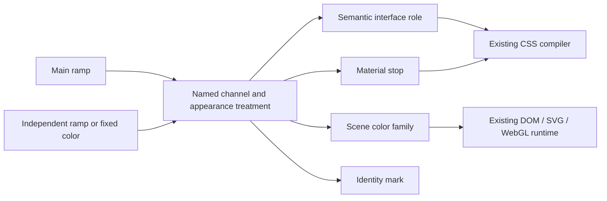

# Color channels

Implemented October 31, 2026. This extends the current v11 engine; it does not replace its color kernel, materials, or motion runtimes. [Theme engine](theme-engine.md) describes those systems. The reference for material craft remains the original [design page](https://www.zimoluo.me/design): concentric corners, translucency, a quiet reading material, and specular highlights on smaller controls.

## Separate a color family from its consumer

A theme owns an arbitrary collection of named color channels. They have no predefined consumer meanings and are not a fixed nine-channel palette. A channel is a named, stable color family owned by that theme. A consumer requests that channel's default color or a shade. Interface roles, material stops, scene palette slots, and mark paints accept the same channel reference. Resolution produces ordinary OKLCh colors; CSS, SVG adaptation, and WebGL continue to consume those resolved colors. There is no second browser-side channel resolver.



The source contract lives in [types.ts](../../src/features/theme/model/types.ts); [schema.ts](../../src/features/theme/model/schema.ts) validates it. A channel has a display name, a source paint, and optional complete light/dark source overrides. Its ID is stable while its display name can change. The keyed representation prevents list insertion, deletion or renaming from changing another consumer’s connection. The nine semantic interface roles are consumer adapters for CSS, not the channel catalog. Multiple roles and artwork slots can connect to one channel; any of them can instead connect to another. Source paints are:

| Source | Meaning |
| --- | --- |
| `tone` | Sample the main ramp, retaining the existing hue/chroma deviation controls |
| `ramp` | Sample a fully independent ramp with its own endpoints, curve, torsion, envelope, and stops |
| `literal` | One deliberate color, independent of shade and the main ramp |

A channel without appearance overrides is fixed across appearances. A light or dark override replaces the source paint for that appearance. A ramp paint's explicit `reverse` maps a requested shade `t` to `1 - t`. This is the only channel shade reversal; role and surface mirroring leave channel references alone. Nothing assumes that every theme or every family needs a counterpart. A fixed-color treatment is a constant color function: it accepts any valid shade and returns the same paint. Consumer shade coordinates stay intact, including when another appearance uses a ramp. The editor hides shade controls for the constant treatment instead of forcing consumers to be rewired.

```json
{
  "channels": {
    "water": {
      "name": "Water",
      "source": { "kind": "ramp", "ramp": { "hue": 230, "chroma": 0.45 }, "at": 0.35 },
      "appearance": {
        "dark": { "kind": "ramp", "ramp": { "hue": 235, "chroma": 0.32 }, "at": 0.35, "reverse": true }
      }
    }
  }
}
```

Any color endpoint can then use `{ "kind": "channel", "channel": "water" }`, or add `"at": 0.2`. A shade belongs to the selected family's ramp. Stop positions and opacity still belong to the material or artwork: changing a channel does not move a gradient, erase a mask, change clipping, or assign a text role automatically.

## Resolution and boundaries

[resolve.ts](../../src/features/theme/model/resolve.ts) selects the theme's appearance, resolves channel defaults, resolves roles, then resolves surfaces, scenes, and the mark. `ResolvedTheme.channel(id, at?)` is the common color query, also used by Studio swatches. Default colors are memoized within that resolved snapshot. Shades use the existing bounded gamut memo and color kernel; no new unbounded global cache is introduced.

Channels cannot reference roles or other channels. Consumers can still reference a semantic role; existing role aliases remain supported. This keeps channel resolution independent of endpoint order and prevents cross-channel/role dependency cycles. Unknown IDs, invalid coordinates, and invalid source paints fail validation. Constant and ramp treatments remain substitutable at the same endpoints. The authoring bound is 128 channels per theme; identifiers are bounded lowercase words separated by hyphens. Runtime callers outside validation also get explicit errors for missing channels and invalid shades.

This is an additive extension of the unreleased v11 version-two theme source. Existing v1 imports and v2 profiles keep their original meanings. Older v11 clients that do not understand channel references cannot edit the new presets; deployment must update the client and engine together. Import/export and account persistence use the same validated source schema.

## Alternatives challenged

| Alternative | Failure | Decision |
| --- | --- | --- |
| Force every paint onto one ramp | Multicolor artwork, independent material hues, and fixed festival themes lose direction | Retain the main ramp and allow independent channel ramps and deliberate fixed colors |
| Add more semantic role names | An artist's palette becomes entangled with the growing list of UI components | Keep nine UI roles; let roles request a family and shade |
| Let every endpoint customize hue, chroma, and appearance again | The channel becomes a label while consumers diverge | A channel endpoint selects only ID and optional shade; family adjustments live on the channel |
| Mirror all colors automatically | Fixed appearances become unwanted counterparts; art gradients lose separation | Appearance overrides and reversal are explicit, per family |
| Reject shades whenever a channel becomes fixed | Changing a treatment invalidates its existing consumers and makes a fixed light / ramp dark family awkward | A fixed treatment is a constant function; retain coordinates and hide irrelevant controls |
| Arbitrary channel expressions and aliases | Cycles, fallback chains, and debugging become another subsystem | Channel sources are bounded, independent color programs; no channel-to-channel graph |
| Quantize similar migrated paints into one family | Near-equal fitting values can encode deliberate art direction | Only exactly matching definitions in every appearance are shared automatically |
| Rebuild artwork calibration from the theme | Editing a preset changes both target and reference, canceling the edit | Original artwork calibration is independent immutable source data |

This model organizes ownership; it does not make arbitrary colors readable. Contrast remains a rendered, composited review. Shared shadow shapes and editor helper colors rebind at the contained theme boundary, so a light draft inside a dark editor uses its own labels and shadow tints. Nor does a well-formed channel prove that a renderer actually paints its advertised slot: [scene consumer contracts](../operations/scene-palette-controls.md) and mutation checks still apply.

## Preset migration and authoring

All 59 presets now declare their published data directly. The former runtime counterpart/mark adapters are removed. The 38 paired and 21 fixed appearances retain their previously published paint; appearance-specific geometry remains in `appearance` only when needed. The source no longer silently becomes a different preset when retrieved from the registry.

The lossless migration produces 915 channel definitions across the collection, with at most 44 in a preset. These include distinct fitted paint points; they are not a claim that the original site has 915 independently designed hue families. This first migration deliberately preserves that information. Grouping those points into fewer artist-authored ramp families requires composition-by-composition review. It must not be approximated by merging visually similar samples. New themes start with one main palette channel and shade requests for their UI roles.

[channels.ts](../../src/features/theme/model/channels.ts) can organize an older profile as one undoable Studio operation. It uses the resolver's shared appearance/orientation selectors, preserves source data, and refuses an oversized result before changing the draft. Studio provides one channel inspector, its color strip, source controls, separate appearance treatment, and connected consumer groups. Unused channels can be removed; used channels cannot be deleted into dangling references. A color picker can link an endpoint to a channel, select a shade, return to the default shade, or explicitly detach into a custom color. Main-ramp role dragging retains a channel binding rather than flattening it into a number.

## Artwork calibration is not editable theme color

[native-artwork-palettes.ts](../../src/features/backdrop/host/native-artwork-palettes.ts) records the original artwork's reference palette. The SVG/raster manifest builder and shader paint helper share it. It is not regenerated from `getTheme`. Native SVG geometry, animation, alpha, clipping and relative shading remain in the source artwork. A target scene palette comes from the theme's channels/roles, and its difference from that stable reference determines recoloring. Editing a preset now changes the target without redefining its baseline.

The compatibility SVG builder still assigns colors to the nearest reference slot. Raster recoloring still uses a filter approximation. Those are explicit remaining limits, not proof that every original paint family has received a bespoke channel port. Structural mask/clipping paint is excluded from editable families; transparent stops are not useful controls.

## Evidence and remaining work

The migration compared all 97 published theme/appearance combinations, including changes to the main hue at 37, 192, and 315 degrees, for compiled CSS, mark and scene output. The channel conversion itself produced byte-identical theme CSS. The subsequent gamut repair preserves already valid literal colors, including pure blue, instead of clipping them against a first-boundary search; affected generated paint is deliberately regenerated. Property tests exercise independent ramp gamut bounds and shade reversal. Cross-consumer tests cover roles, materials, mark, and scene colors; further tests cover fixed colors, missing channels, malformed imports, profile round trips, independent appearance treatments, sparse legacy sources, raw layers and conflicting identities. Browser verification belongs in the dated fidelity log.

This does not close the full site craft audit or the per-scene animation-phase/browser matrix. Track them in [the craft audit](../implementation/craft-audit-matrix.md) and [the fidelity log](../implementation/site-fidelity.md).
