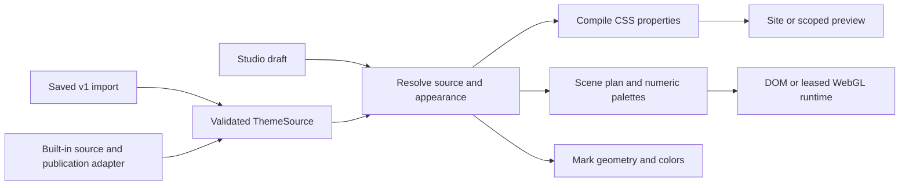

# Theme engine today

Updated October 31, 2026 for explicit color channels and preset publication. This describes the current engine, including its compromises. [The channel architecture](color-channels.md) explains the new ownership model; the existing engine capabilities are retained.

## Source, resolution, compilation, presentation

[`ThemeSource`](../../src/features/theme/model/types.ts) is versioned, JSON-compatible authoring data: a main ramp, named color channels, semantic roles, scheme availability, surface layers/lenses, scene references, mark configuration, and reading defaults. [`schema.ts`](../../src/features/theme/model/schema.ts) validates imported/saved data and role alias cycles. Legacy imports go through `lift-v1.ts` and revalidation.

[`resolve.ts`](../../src/features/theme/model/resolve.ts) produces `ResolvedTheme`: concrete OKLCh roles, surfaces, mark, scene palettes, reading defaults, and a tone sampler. It fills defaults, resolves references, orients surfaces and applies appearance overrides. It is synchronous and separate from DOM application.

[`compile.ts`](../../src/features/theme/compile/compile.ts) turns resolved data into CSS property maps: `--zw-role-*`, surface images/base/alpha/lens, variation images, reflection/shadow colors, reading blur, backdrop colors, and mark stops. `applyProperties` compares maps, writes changed properties, and removes retired properties. Compilation does not itself select a route, persist a preference, or run an animation.

Presets declare their published light/dark treatments directly; there is no runtime counterpart or mark adapter. Built-ins use [`tools/build-theme-css.ts`](../../tools/build-theme-css.ts) and root `data-theme`/`data-scheme` selectors. Saved profiles use [`ThemeHost`](../../src/features/theme/runtime/ThemeHost.tsx) to compile root overrides. Initial selection and changes of profile identity or effective appearance paint synchronously, preventing an empty-profile frame after the selector changes. Ordinary edits within the same profile/appearance coalesce into a scheduled frame. Studio applies a draft to a contained preview through its own controller, leaving the editor in the site's published material. Studio page/window views share a reference-counted editing session. Existing profiles autosave validated edits after a gesture settles; new drafts require save/apply to become profiles. Inspection position and disclosure state belong to the individual view. Marks and backdrops also resolve their controller's source; there is currently no shared resolved-snapshot cache across those consumers.

## Colors: what the numbers mean

The kernel is under [`color/`](../../src/features/theme/color/index.ts). A ramp's `t` runs from lightest at 0 to darkest at 1. Default endpoints are 0.985 and 0.165 OKLCh lightness. `ease` shapes lightness; the default is a small sinusoidal departure from linear. Ramp `ease` is a **color curve**, not animation timing.

Hue is `hue + torsion * (t - .5)`, normalized around the circle. Authored chroma is a fraction of the sRGB boundary at that lightness/hue, optionally multiplied by an envelope. `maxChroma` finds the boundary by bisection; `toGamut` reduces chroma while retaining lightness/hue. Stops can override lightness, hue, relative chroma, or a literal color; deviations interpolate between neighboring stops with shortest-arc hue handling.

Gamut-relative chroma is an authoring convention for available headroom. It is not a promise that equal fractions have equal perceptual vividness or that resulting text has adequate contrast. Internal math currently supports sRGB; requesting Display P3 conversion throws, although gradient syntax supports additional CSS interpolation spaces.

Named channels own a main-ramp sample, independent ramp, or fixed color with optional appearance treatments. All color endpoints can request a channel and optional shade; channel references bypass legacy role/material mirroring. See [the complete contract and alternatives](color-channels.md).

Roles are `text`, `textMuted`, `line`, `fill`, `panel`, `edge`, `shade`, `accent`, and `brand`. Each can request a channel, a ramp position, a tone with deviations, a literal, or another role's alias. Layer/scene/mark references can use a channel, role, tone, or literal. Literal colors are an intentional capability for multicolor and art-directed themes, not inherently a migration failure.

Studio exposes contrast-ratio and APCA-style diagnostics from [`contrast.ts`](../../src/features/theme/color/contrast.ts); neither validation nor gamut mapping establishes readable composited UI automatically. Checking colors over translucent materials and animated backgrounds still requires rendered review.

Valid sRGB colors are returned unchanged before considering a chroma cap. This matters at the blue cusp, where a ray can leave and reenter the gamut; a first-boundary radial search must not reduce an already valid literal. The implementation's simple chroma cap for out-of-gamut inputs remains a deliberate project algorithm, not a claim to implement the browser's full CSS gamut-mapping algorithm. [CSS Color 4](https://www.w3.org/TR/css-color-4/#gamut-mapping) describes browser gamut mapping; [Oklab's original account](https://bottosson.github.io/posts/oklab/) supplies the perceptual-space background.

## Requested mode is different from supported appearance

`schemePreference` is light/dark/system. Store `scheme` is the current requested mode after system resolution. Explicit route/profile choices take precedence over seasonal defaults, so saving a Studio profile remains effective after reload. Seasonal selection fills routes without a saved choice. `effectiveScheme(source, requested)` chooses an available published appearance; HTML `data-scheme` represents that effective appearance. A fixed light theme can therefore render light while retaining a dark preference for the next paired theme or route. The render cookie retains the requested mode.

A single source declares one scheme. A dual source carries light roles, optional dark overrides, optional role mirroring, and review flags. `schemesOf` determines published availability; `previewScheme` allows Studio to inspect an unpublished counterpart. `appearance[scheme]` can override surfaces, backdrop and mark. `surfaceScheme` describes an authored material's orientation when resolving it for the requested appearance. These mechanisms overlap: roles, material orientation, and per-appearance paint are resolved separately.

Current defaults may be mirrored when resolving a dual dark appearance. Explicitly oriented authored materials can mirror tone references and transform literal lightness through the ramp. Raw layers remain unchanged. `resolveWithWarnings` reports certain literal-in-mirrored-surface cases; it does not perform a full visual review.

The historical built-in counterpart recipe, now materialized in explicit channel appearance treatments, treats page artwork separately from controls. Its previous universal low-chroma/narrow-lightness mapping erased rings, stripes and multicolor washes. For `page` and `page-reduced`, the adapter measures the authored page's nontransparent lightness bounds, reverses their ordering into a readable lightness band (0.78–0.97 for light, 0.12–0.42 for dark), and compresses only when the authored span exceeds that band. Transparent stops do not distort the bounds. Hue and chroma relative to the available sRGB gamut are retained; geometry, alpha, bindings, interpolation and layer ordering are unchanged. The reduced artwork uses the full page's mapping so reducing detail does not independently change the palette. Controls retain their quieter recipe. These are preserved published treatments, not runtime generation policy or a restriction on saved-theme authoring or the resolver's expressive capabilities.

## Materials and identity

Surfaces are `page`, `page-reduced`, `widget`, `raised`, `sunken`, `overlay`, and `nested`. Typed linear/radial/conic layers carry stops, interpolation, enabled state and alpha binding; raw CSS is a validated escape hatch. Surface alpha is separate from stop alpha, with fixed/scaled binding. A lens adds blur, saturation and brightness. Variation produces finite rotated/shifted/nudged images at compile time, not random paint per render.

[`surfaces.css`](../../src/styles/surfaces.css) supplies the shared drawing model. The specular perimeter and shadow geometry belong to that design system rather than individual theme files. Theme colors tint the material. Shared shadow geometry lives in `globals.css`; `:root` and `[data-theme-scope]` bind those shapes to the local tint values. Tailwind and authored CSS consume the same `--zw-shadow-*` shapes, so a contained draft does not inherit a shadow already resolved against the published theme. Studio preview helpers likewise rebind their local text/material aliases at the preview boundary. Page materials, previews and thumbnails consume both fixed and scaled paint with surface opacity. The compiler still exposes historical reflection families (`primary`, `saturated`, `pastel`, `light`), and [`reflect.ts`](../../src/features/theme/compile/reflect.ts) still uses an HSL-derived highlight/ambient calculation. Thus `color-convert` is used beyond the legacy importer; older status notes saying it is import-only are outdated.

Mark modes are outline, unified, split, backdrop, and scene. The mark resolves through the same source/appearance/controller. One gradient may supply all split regions. Scene marks use the shared backdrop/mark infrastructure. [`ThemeMark`](../../src/features/theme/runtime/ThemeMark.tsx) subscribes to structural changes and applies paint imperatively; exports share the mark geometry. Browser icons include generated build assets; a blanket color inversion is not the model for identity appearance.

## Motion and scenes

Scene definitions explicitly declare their effective color controls; the previous generic five-slot editor fallback is removed. Saved palette records remain open and retained. [Scene palette controls](../operations/scene-palette-controls.md) records all 36 consumer contracts, conditional fields, rich-only hints, alpha-mask/transparent-stop cases and rendered verification.

Theme source chooses scene IDs, palette references, parameters and optional routes. Scene modules under [`backdrop/registry`](../../src/features/backdrop/registry/index.ts) declare parameter bounds/defaults, rendering kind, cost and themeability. [`planScenes`](../../src/features/backdrop/plan.ts) validates parameters, filters route applicability, and selects quality.

| Input | Result |
| --- | --- |
| Backdrops off | Unmounted |
| OS reduced motion | Still |
| Reduced backdrop preference or data saving | Reduced; high-cost scenes become still |
| Full preference without those constraints | Rich |

Source validation currently checks the scene-reference shape rather than guaranteeing a known scene ID and recognized palette slots. Planning skips unknown scene IDs; parameter validation clamps/defaults values, but the planner currently discards its issue list. Stronger diagnostic/publication validation belongs in the cleanup contract.

Interaction transitions use OS/settings preferences plus authored CSS/Web Animation timing. They do not get a timing curve from the color ramp. Scene speed is a scene parameter; each scene owns its animated implementation. There is not one universal theme-motion compiler.

Structural scene changes can remount hosted scenes. Palette and supported numeric parameter changes update stable runtime inputs, CSS properties and shader uniforms. Removed owned scene properties are retired as well as changed ones being written; artwork-owned properties are retained. DOM scenes have their own resource owners. WebGL scenes share one document renderer with an exclusive lease: a focused contained Studio gets the live canvas; other hosts retain captured frames. This deliberately pauses their live WebGL animation rather than maintaining one renderer per preview. [Backdrop operations](../operations/backdrop-runtime.md) and ADR-050 explain the resource and stacking tradeoff.

Old artwork is adapted through paint manifests and native reference palettes. Vector paints preserve authored lightness/chroma/hue relationships around palette changes; raster art uses a filter approximation. These are current compatibility mechanisms, not proof that every scene can be recolored arbitrarily without losing its intended art direction.

## Current ownership and migration limits

All 59 published sources now contain explicit channels: 915 definitions, at most 44 in one preset. There are 38 paired and 21 fixed appearances. The first migration is lossless and does not claim that every fitted paint point is already grouped into its ideal art-directed family. The previous inventory of 59 raw single-scheme files and generated runtime counterparts describes the historical `91d20ccf` implementation, not the current registry.

The removed `reviewed-schemes.ts` and `reviewed-marks.ts` adapters used ID-specific recipes to publish different data from the authored source. Their output now lives in the source files. Review flags remain publication intent, not independent evidence of visual review. The channel conversion initially retained byte-identical generated CSS; the later valid-color preservation repair intentionally regenerates affected literal paint. The theme CSS remains within the 60KB Brotli budget; migration equivalence does not establish that every composition is polished.

Original artwork calibration now lives independently of presets. The SVG manifest builder and shader helper use the same static reference data, preventing a preset edit from recalibrating its own recoloring baseline and canceling the change. Nearest-slot SVG grouping and raster filter approximation remain limitations requiring individual scene review.

The exact-coordinate gamut memo remains bounded at 8,192 entries with oldest-entry eviction. Further debt includes repeated theme compilation across hosts, profile references based on array indexes, and the full site/scene visual matrix. Channels do not remove those unrelated concerns. [The craft audit](../implementation/craft-audit-matrix.md) records the remaining scope.
